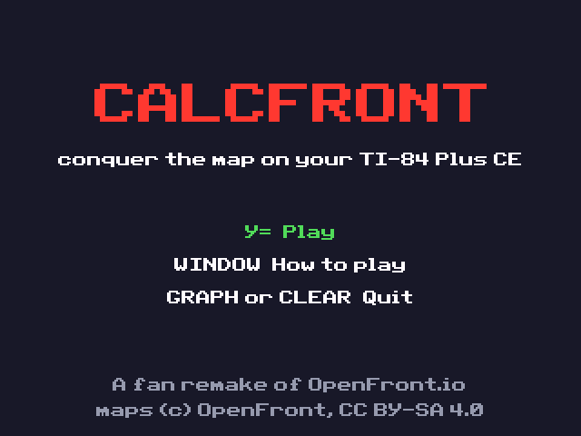
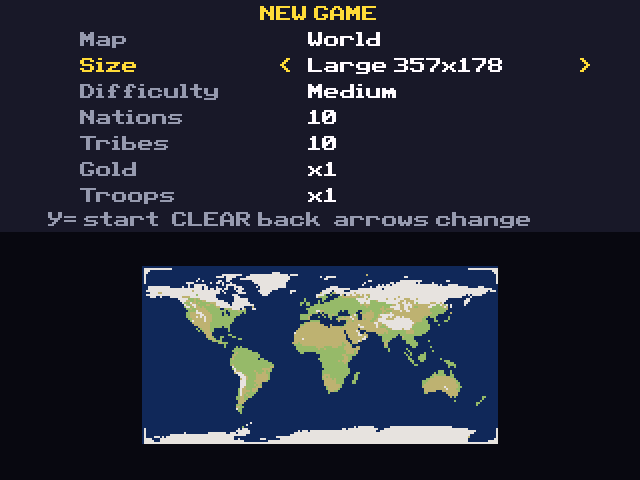
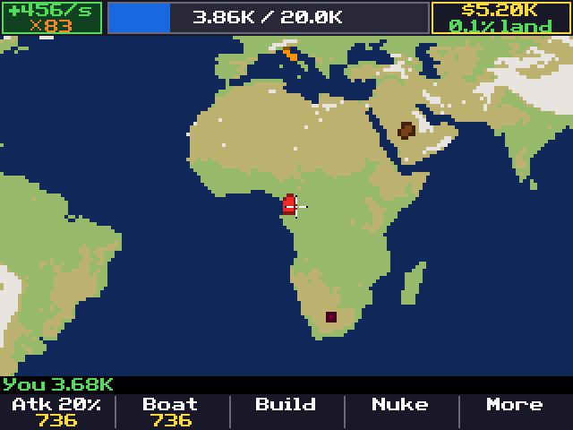
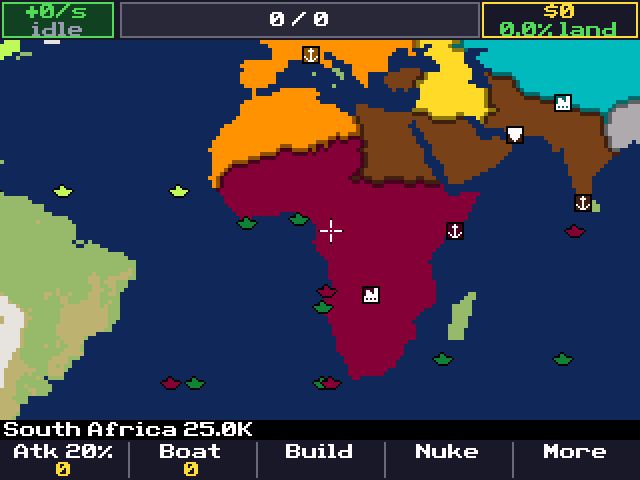
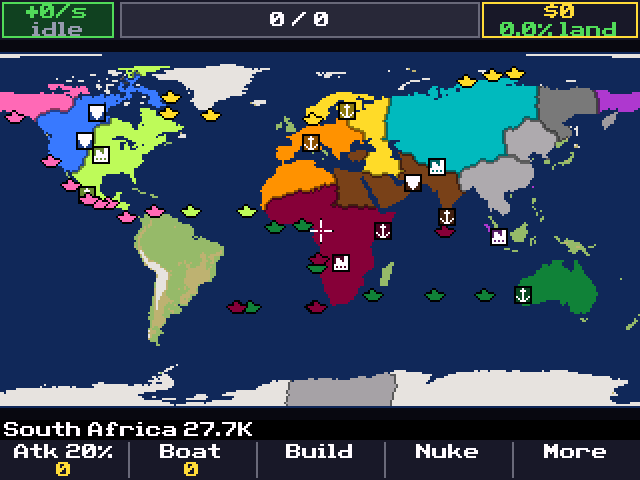
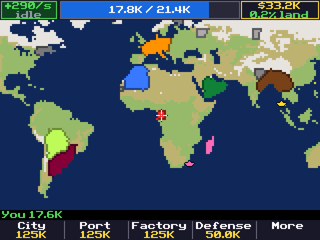

# CalcFront

**A territory conquest strategy game for the TI-84 Plus CE, inspired by
[OpenFront](https://openfront.io).** Spawn anywhere on a real-world map, grow your
army, push your borders, build ports, factories and railways, fight at sea, sign
alliances (and break them), and launch nukes, against up to 30 computer players.

> [!NOTE]
> **This project is vibecoded.** It was written almost entirely by an AI
> (Anthropic's Claude) under the direction of [ArthusPVP](https://github.com/ArthusPVP),
> tested in an emulator and on PC. Expect rough edges.
> **Forks, issues and pull requests are very welcome**: improve it, fix it,
> port it, make it yours.

| | | |
|:-:|:-:|:-:|
|  |  |  |
|  |  |  |

*Screenshots from the CEmu emulator.*

## Features

- **15 maps converted from OpenFront**: World, Europe, Africa, Asia, North America,
  South America, Oceania, MENA, Britannia, Japan, Black Sea, Italia, Australia,
  Pangaea and Mars. Seven of them also come in a **Large** version with about
  twice as many tiles (World goes from 256×128 to 357×178).
- **Computer opponents**: *nations* (smart AI, with the real names and start
  positions from each map) and *tribes* (the passive grey bots of OpenFront).
- **Four difficulties** using OpenFront's own nation multipliers: Easy, Medium,
  Hard, Impossible.
- **Game options**: map, map size, difficulty, number of nations (up to 24) and
  tribes (up to 30 players in total), gold multiplier and troop multiplier
  (×0.5 to ×5).
- **OpenFront's rules**, scaled to the smaller maps:
  - troop cap `2·(tiles^0.6·1000 + 50000)` plus cities, troop growth that is fastest
    around half of your cap, troops shown divided by 10 like in OpenFront;
  - an **OpenFront-style troop bar**: growth per second, troops at home (blue),
    troops out attacking (orange), cap, gold and land share;
  - attacks with an adjustable troop ratio, terrain costs (plains, highland,
    mountain), defense posts, fallout, traitor penalties, big-empire bonuses;
  - transport **boats** to attack across the sea;
  - **ports** with levels that send **trade ships** to other ports (gold for both
    sides, more for long routes, bonus for allies);
  - **factories** that link nearby cities, ports and factories with **railways**,
    and **trains** that earn gold at every stop;
  - **warships** with health, shells, repairs at port, veterancy, that sink boats,
    fight other warships and capture trade ships, and can be sent anywhere at sea;
  - **missile silos**, **SAM launchers**, **atom bombs**, **hydrogen bombs** and **MIRVs**;
  - **alliances** (5 minutes), alliance requests, betrayal, targets, embargoes;
  - win by owning 80% of the land.
- **Save and resume**: save from the pause menu, continue from the title screen.
- **A clean screen** with only what you need, more in *More > Info*, and a hidden
  **pro mode** that shows every number (see [Pro mode](#pro-mode)).
- **Optimised for the eZ80**: runs at OpenFront's full 10 ticks per second in
  CEmu, even on Large maps with 30 players and 80+ units on screen (see
  [Performance](#performance)).

## Install on your calculator

1. **Download** `CalcFront.zip` from the
   [Releases](https://github.com/ArthusPVP/CalcFront/releases) page (or from the
   artifacts of the latest [Actions](https://github.com/ArthusPVP/CalcFront/actions) run).
   It contains `CALCFRNT.8xp` (the game) and `maps/*.8xv` (the maps).
2. **Download the CE C libraries**: `clibs.8xg` from
   **https://github.com/CE-Programming/libraries/releases/latest**.
   CalcFront needs them (graphx, keypadc, fileioc...); without them the game
   shows *Need LibLoad*.
3. **Send** `clibs.8xg`, `CALCFRNT.8xp` and the `CF*.8xv` map files to the
   calculator with [TI Connect CE](https://education.ti.com/en/products/computer-software/ti-connect-ce-sw)
   or [TiLP](https://github.com/debrouxl/tilp_and_gfm). Sending them to the
   Archive is fine and recommended. You can skip maps you don't want.
4. **Run** it:
   - OS 5.3 and 5.4: `prgm` → `CALCFRNT` → `enter` `enter`;
   - OS 5.0 to 5.2: `Asm(prgmCALCFRNT)` from the home screen;
   - OS 5.5 and newer: TI disabled assembly and C programs. The community tool
     [arTIfiCE](https://yvantt.github.io/arTIfiCE/) brings them back; check its
     page for the OS versions it supports.

The game needs about **135 KB of free RAM** while it runs (113 KB of program
code plus 20 KB of work memory, which it creates as a temporary `CFTMP`
variable and deletes on exit). Archive other programs and variables if you get
*Not enough free RAM* or *ERR:MEMORY*.

## How to play

Pick a map and the options, choose where to start with the cursor, then grow.
Attack free land first, build cities to raise your troop cap, ports and
factories for gold, and don't let your troops sit at the cap: they grow fastest
around half of it.

### Controls

| Key | Action |
|---|---|
| Arrows | Move the cursor (hold to move faster) |
| `8` `4` `6` `2` | Scroll the map |
| `+` / `−` | Zoom in / out (1, 2, 4 or 8 pixels per tile) |
| `enter` | Attack the land under the cursor (or send the selected warship there) |
| `clear` | Back / pause menu (Resume, Help, **Save**, Quit) |
| `y=` `window` `zoom` `trace` `graph` | The five action keys, labelled on the bottom bar |

### Action keys

| Menu | `y=` | `window` | `zoom` | `trace` | `graph` |
|---|---|---|---|---|---|
| Main | Attack (shows the ratio and the troops sent); **Ship** when the cursor is on your warship | Boat (attack across the sea) | Build | Nuke | More |
| Build (on land) | City | Port | Factory | Defense post | More: Silo, SAM |
| Build (on water) | Warship | | | | Back |
| Nuke | Atom bomb | Hydrogen bomb | MIRV | | Back |
| More | Diplomacy | Attack ratio −10% | Attack ratio +10% | Info (your stats, leaderboard) | Game speed |
| Diplomacy | Ally / Betray | Target | Embargo / Trade | Retreat | Back |
| Warship selected | Go here (patrol) | | | | Done |
| Alliance request | Accept | Refuse | | | |
| Pause | Resume | Help | Save | | Quit |

A greyed-out key means you cannot pay for it yet. Building on one of your
existing buildings of the same type upgrades it.

### Ships

Transport boats are drawn as an **x**, trade ships as a **dot** and warships
as a **+**, in their owner's colour. Zoomed all the way out, trade ships and
trains are not drawn, so the map stays readable.

### Saving

Pause with `clear` and press `zoom` (**Save**). The game is stored in the
AppVars `CFSAVE0`, `CFSAVE1`... (usually 2 of them, under 16 KB in all), moved
to the archive as they are written. Pick **Continue** on the title screen to
resume. There is one save slot; saving again replaces it.

### The status bar

`[████ 4.53K / 12.1K ████]  $5.50K  12.3%`: your troops (blue: at home,
orange: out attacking) against your cap, your gold and your share of the land
(land tiles only, never water). Like OpenFront, troop numbers are shown
divided by 10. *More > Info* shows the rest: growth per second, troops out,
rank, buildings, warships, alliances with the time they have left, who attacks
you, embargoes and the game time.

### Pro mode

On the **New game** screen, enter the Konami code: `↑ ↑ ↓ ↓ ← → ← →`, then
`apps` (B) and `math` (A). Pro mode shows every number: growth per second and
troops out next to the troop bar, land share to 0.01%, prices and troop counts
under the action keys, terrain, levels, health and veterancy under the cursor,
and the game clock. The same code turns it off; the choice is remembered.

### Prices (OpenFront's)

| | Price |
|---|---|
| City | 125K, doubling with every city level you own, up to 1M |
| Port, Factory | 125K, doubling with every port and factory level you own, up to 1M |
| Defense post | 50K more for each one you own, up to 250K |
| Missile silo | 1M |
| SAM launcher | 1.5M, then 3M |
| Warship | 250K more for each one you own, up to 1M |
| Atom / Hydrogen bomb | 750K / 5M |
| MIRV | 25M, +15M for each MIRV launched in the game |

## Maps

| Map | Normal | Large | Nations |
|---|---|---|---|
| World | 256×128 | 357×178 | 40 |
| Europe | 256×147 | 333×191 | 40 |
| Africa | 245×256 | | 40 |
| Asia | 256×154 | 326×195 | 25 |
| North America | 256×132 | 351×181 | 40 |
| South America | 188×256 | 216×294 | 25 |
| Oceania | 256×154 | | 22 |
| MENA | 256×112 | 382×167 | 35 |
| Britannia | 196×256 | | 20 |
| Japan | 252×252 | | 12 |
| Black Sea | 256×188 | | 9 |
| Italia | 256×239 | | 15 |
| Australia | 256×192 | | 7 |
| Pangaea | 252×252 | | 28 |
| Mars | 256×128 | 357×178 | 6 |

Each map is one AppVar (`CFxxxxxx.8xv`, 2–12 KB) holding all its sizes. A map
holds at most 64,000 tiles (the limit of 16-bit tile indices and of the free
half of the screen memory where the map lives). Africa is already at that size,
so it has no Large version. Previews are in [`maps/preview`](maps/preview).

## Building from source

You need the [CE C toolchain](https://github.com/CE-Programming/toolchain)
(`CEdev`, tested with v15.0) and `make`.

```bash
make
```

The program is written to `bin/CALCFRNT.8xp`. The map AppVars are already in
[`maps/calc`](maps/calc). To regenerate them from OpenFront's sources (needs
Python 3 with numpy and Pillow):

```bash
tools/fetch_maps.sh
```

```bash
python3 tools/mapconv.py
```

Every push to `main` is built by [GitHub Actions](.github/workflows/build.yml),
which packages the game, the maps and install notes into `CalcFront.zip` and
updates the *Latest build* pre-release. Pushing a `v*` tag publishes a release.

### Testing

- **PC simulation harness** ([`host/`](host)): runs the same game core natively,
  with every computer player in charge (including player 1), and checks the game
  state for consistency every 128 ticks under AddressSanitizer and UBSan. It needs
  the PC map files made by `tools/mapconv.py`.

  ```bash
  make -C host
  ```

  ```bash
  ./host/cfhost world 2 20 10 12000 1
  ```

  Arguments: map, difficulty (0–3), nations, tribes, ticks, seed, and optionally
  a frame interval and a folder to dump PPM images. `CF_SIZE=1` picks the Large
  map, `CF_GOLD` and `CF_TROOPS` the multipliers (index 0–5, 1 = ×1).
  `CF_SAVE=n` saves the game at tick `n`, loads it back, checks that nothing
  changed and plays on. The summary line also reports the sea routes searched
  (and the most tiles one search looked at) and the boats that found no route.
- **Emulator** ([`tools/cemu_run.py`](tools/cemu_run.py)): drives a headless
  [CEmu](https://github.com/CE-Programming/CEmu) (with the small `launch` command
  from [`tools/cemu-headless-launch.patch`](tools/cemu-headless-launch.patch)),
  sends the game, maps and C libraries, plays a key script and saves screenshots.
  You need your own TI-84 Plus CE ROM dump (`CF_ROM=...`).
- **Profiling**: `make CFLAGS="-Wall -Wextra -Oz -fno-inline-functions -DCF_PERF"` builds a benchmark (see [Architecture](docs/ARCHITECTURE.md#profiling)) that
  shows, every 100 game ticks, the time spent in each part of the game and of
  the drawing at the bottom of the screen.

## Performance

The TI-84 Plus CE runs an eZ80 at 48 MHz with slow memory: in practice a few
million simple instructions per second, and multi-bit shifts on 16/24/32-bit
values are slow library loops. To reach OpenFront's 10 ticks per second:

- the map lives in the unused half of video memory, one byte per tile;
- tile coordinates, bitmaps, log2/exp2 use byte tables and byte moves, no shift loops;
- ship routes are guided by a coarse map of 8×8-tile cells: a quick search
  over the cells counts how far each one is from the goal, and the tile search
  follows that count around continents instead of filling every bay (at most
  about 1,100 tiles looked at for any route, against up to 25,000 before);
  routes are shared through a cache;
- per-tile attack costs are computed once per tick per terrain type;
- unit loops only cover slots in use, and per-player unit counts are cached;
- the screen is redrawn incrementally: only tiles that changed, sprites that
  moved, and sprites or buildings that a 16×16 dirty-cell grid says were painted
  over; scrolling slides the picture already in video memory and paints only
  the strip that comes into view;
- the status bar, info line and action keys are only redrawn when what they
  show changes; the land share uses a cached reciprocal instead of a division.

## Project layout

```
src/main.c        game flow, input, menus
src/ce/           calculator front end: renderer, HUD
src/sim/          portable game core (no calculator headers), save format
host/             PC test harness for the game core
tools/            map converter, map fetcher, emulator driver
maps/calc/        map AppVars for the calculator
maps/preview/     map previews
packaging/        notes shipped in the release zip
docs/             screenshots and the original design plan
```

## Documentation

- [Architecture](docs/ARCHITECTURE.md): how the files fit together, memory layout, what happens in one tick.
- [Roadmap](docs/ROADMAP.md): ideas for future improvements.

## Contributing

Anything goes: bug fixes, balance, new maps, better AI, smaller code, ports to
other calculators. Fork the repository, make your change, run the PC harness
and (if you can) the emulator, and open a pull request. If you just found a bug,
an issue with the map, settings and what happened is great too.

## Licences and credits

- **CalcFront's code** is licensed under the
  [GNU Affero General Public License v3.0](LICENSE). It ports game rules and
  formulas from OpenFront, whose code is AGPL-3.0, so CalcFront uses the same
  licence. If you distribute a modified version, share its source.
- **Map data** (`maps/`) is derived from OpenFront's maps
  (`resources/maps`), © OpenFront and contributors, licensed
  [CC BY-SA 4.0](https://creativecommons.org/licenses/by-sa/4.0/). The derived
  map files are shared under the same licence. Details and the list of changes
  are in [`maps/LICENSE.md`](maps/LICENSE.md).
- **[OpenFront](https://github.com/openfrontio/OpenFrontIO)**: the original game
  (code AGPL-3.0, assets CC BY-SA 4.0). CalcFront is an unofficial fan project,
  not affiliated with or endorsed by OpenFront. No proprietary OpenFront asset is
  used.
- **[CE C toolchain](https://github.com/CE-Programming/toolchain)** (LGPL-3.0):
  compiler and runtime linked into `CALCFRNT.8xp`. Since CalcFront's full source
  is available, you can rebuild it against a modified toolchain.
- **[CE C libraries](https://github.com/CE-Programming/libraries)**
  (BSD-2-Clause): graphx, keypadc, fileioc and LibLoad, loaded at run time from
  `clibs.8xg`, which you download from their project (not redistributed here).
- **[ZX0](https://github.com/einar-saukas/ZX0)** by Einar Saukas (BSD-3-Clause):
  compression of the program and the maps, through the toolchain.
- **[CEmu](https://github.com/CE-Programming/CEmu)** (GPL-3.0): emulator used for
  testing only. `tools/cemu-headless-launch.patch` is a small patch to it, under
  GPL-3.0; CEmu itself is not distributed here.
- Python tools use [NumPy](https://numpy.org) and [Pillow](https://python-pillow.org).
